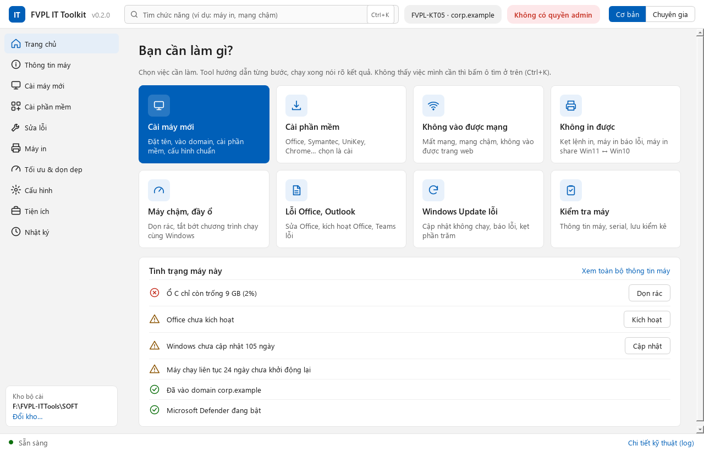
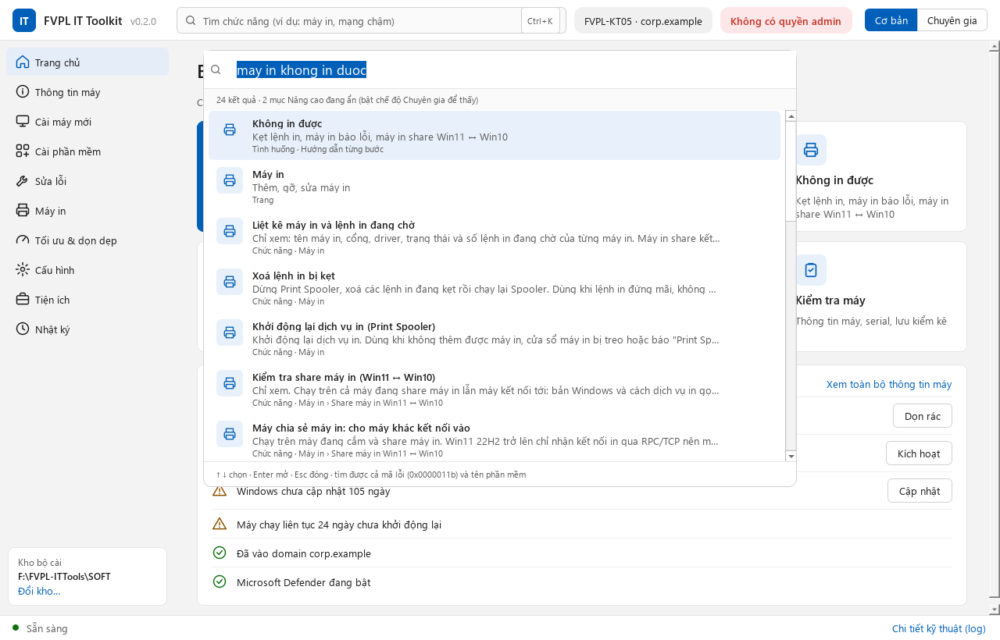
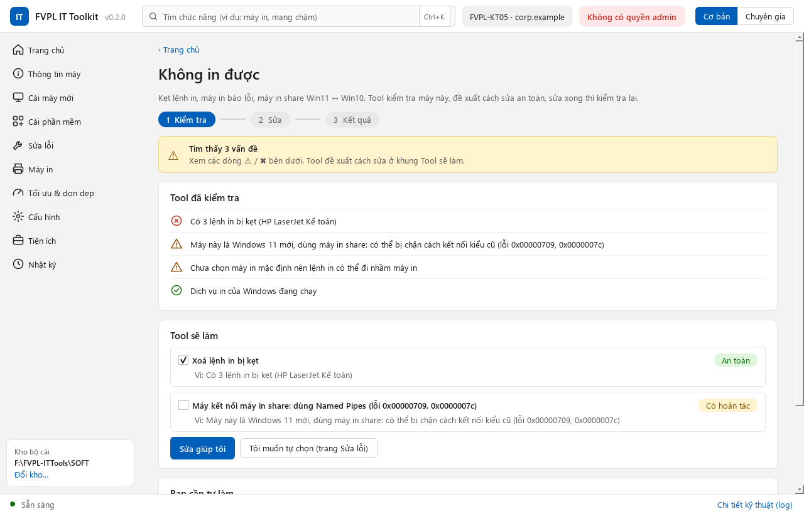
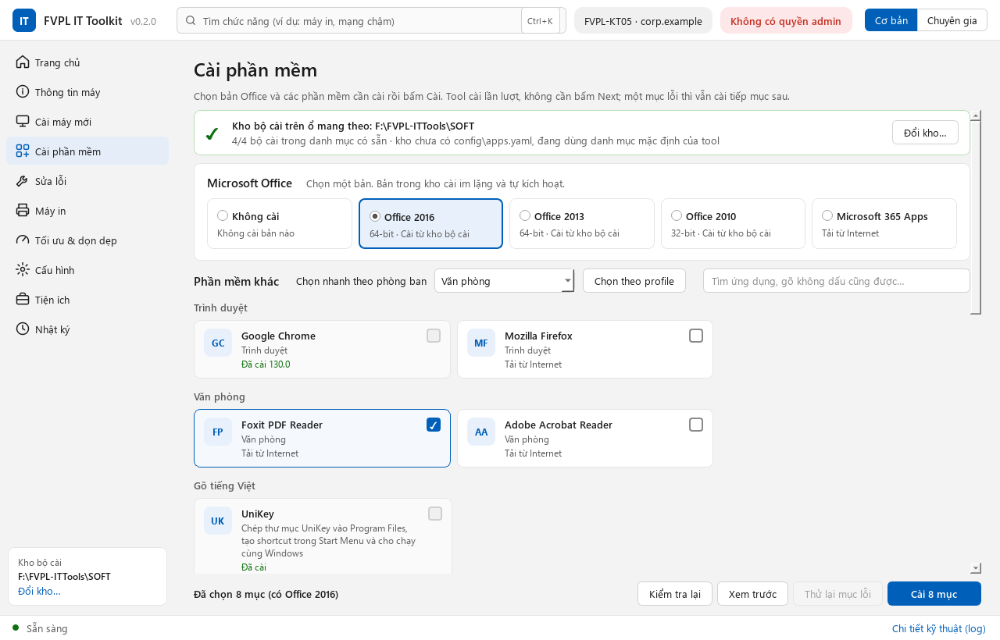
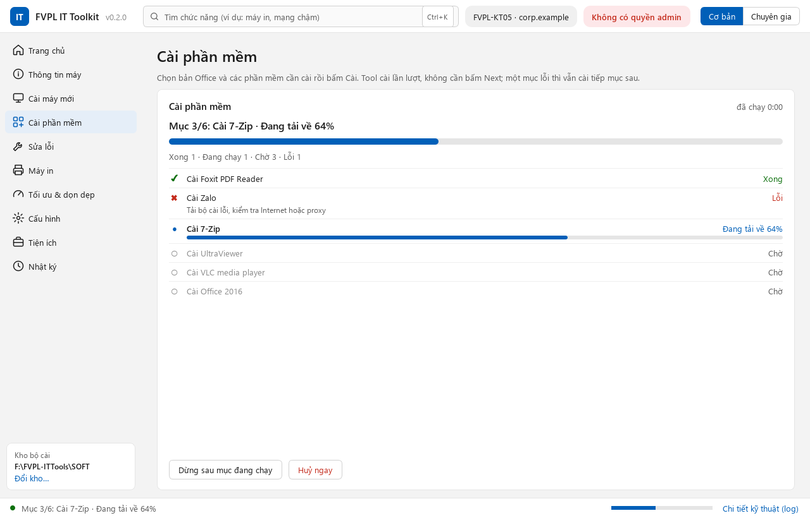

# Hướng dẫn sử dụng FVPL IT Toolkit

Viết cho IT dùng tool hằng ngày. Cách sửa / thêm chức năng cho tool xem [README](../README.md) và [ACTIONS.md](ACTIONS.md).
Tên domain, share trong tài liệu là ví dụ; thông tin thật nằm trong `site.yaml` cạnh tool.

Mục lục: [1. Chuẩn bị](#1-chuẩn-bị-làm-một-lần) · [2. Mở tool](#2-mở-tool) · [3. Cài máy mới](#3-cài-máy-mới-wizard) ·
[4. Cài Office](#4-cài-office-2010--2013--2016-bản-volume) · [5. Cài Symantec](#5-cài-symantec-endpoint-protection) ·
[6. Phần mềm khác](#6-phần-mềm-khác) · [7. Các trang còn lại](#7-các-trang-còn-lại) · [8. Khi có lỗi](#8-khi-có-lỗi)

---

## 1. Chuẩn bị (làm một lần)

### 1.1 Hai bản mang theo

| Bản | Dùng khi | Trên ổ có |
|---|---|---|
| **USB** | Sửa lỗi hằng ngày, cài phần mềm qua mạng | `FVPL-ITTools\` (tool) + `site.yaml` |
| **SSD** | Cài máy mới, không cần mạng / share | Như USB + `FVPL-ITTools\SOFT\` (ISO Office, Symantec, UniKey…) |

Chép ra ổ sau khi build (trên máy có mã nguồn):

```powershell
.venv\Scripts\python packaging\build.py
.venv\Scripts\python packaging\deploy.py usb E:\
.venv\Scripts\python packaging\deploy.py ssd F:\
```

Tool tự chọn **kho bộ cài**: có thư mục `SOFT` cạnh file exe thì dùng nó, không thì dùng share `share_root` trong
`site.yaml`. Trang Cài phần mềm luôn ghi đang dùng kho nào.

**Phát hành bản mới lên share** để mọi IT biết có bản mới:

```powershell
.venv\Scripts\python packaging\deploy.py share \\fileserver\IT$\ITTools\Releases --note "Sửa lỗi theo tình huống"
```

Lệnh chép thư mục `FVPL-ITTools-v<bản>`, file zip và ghi `version.json` vào thư mục đó (đặt `release_dir` trong
site.yaml trỏ tới đây; bỏ trống thì tool tìm ở `<kho bộ cài>\ITTools`). Lúc mở, tool đọc `version.json`; bản trên share
mới hơn thì Trang chủ hiện **Có bản tool mới … · Mở thư mục bản mới** để chép ra USB / SSD (tool không tự ghi đè chính nó).
Ký số file exe trước khi phát hành: xem [KY-SO.md](KY-SO.md).

### 1.2 `site.yaml`

Chép từ `site.example.yaml`, đặt cạnh file exe. Các khoá: `domain`, `netbios_domain`, `share_root`, `computer_prefix`,
`computer_ou` (OU chung của máy trạm), `it_admins_group` (nhóm IT thêm vào Administrators), `departments` (mã phòng,
tool tự thêm khi bồ bấm "Thêm mã phòng" trong wizard).

### 1.3 Kho bộ cài (`SOFT` trên SSD hoặc thư mục share)

```
SOFT\
├── config\apps.yaml                     danh mục phần mềm công ty, profile phòng ban
├── config\office\office2016-standard.xml   cấu hình cài im lặng Office (điền key MAK ở đây)
├── config\office\office2013-standard.xml
├── config\office\office2010-standard.xml
├── SW_DVD5_Office_2016_64Bit_English_MLF_X20-42479.ISO
├── SW_DVD5_Office_2013w_SP1_64Bit_English_MLF_X19-34904.ISO
├── Microsoft Office 2010 Standard Edition X86 SP1.iso
├── Symantec\SEP-14.3-RU9-Win64\          gói client đã giải nén (Sep64.msi) + SyLink.xml của SEPM
├── UniKey\                               thư mục UniKey (có UniKeyNT.exe)
└── Drivers\Printers\<hãng>\              driver máy in đã giải nén (có file .inf)
```

**Điền key MAK cho Office:** mở từng file `config\office\officeXXXX-standard.xml`, bỏ dấu chú thích dòng `PIDKEY` và
điền key:

```xml
<PIDKEY Value="XXXXX-XXXXX-XXXXX-XXXXX-XXXXX" />
<Setting Id="AUTO_ACTIVATE" Value="1" />
```

`AUTO_ACTIVATE` có sẵn: cài xong Office tự kích hoạt nếu máy có Internet. File có key **không** được đưa lên git hay
gửi ra ngoài.

**Tool tìm kho ở đâu:** thư mục `SOFT` nằm cạnh file exe (bản SSD) → kho đã chọn bằng nút **Chọn kho…** → `share_root`
trong site.yaml. Đầu trang Cài phần mềm luôn có một dòng cho biết đang dùng kho nào, có đủ bộ cài không. Chạy bản zip
không kèm `SOFT` thì dòng đó báo **Chưa có kho bộ cài**: bấm **Chọn kho…**, chọn thư mục `SOFT` (trên SSD, USB hoặc
thư mục chung trên mạng). Tool nhớ kho đã chọn cho lần sau trên máy đó.

Trong `config\apps.yaml`, các bản Office có dòng `choice: office` để trang Cài phần mềm gom chúng thành thẻ chọn một bản
(xem [SOFTWARE.md](SOFTWARE.md)).

**SyLink.xml cho Symantec:** gói "All Clients" tải từ Broadcom là bản *unmanaged* (không báo về SEPM). Muốn client tự
vào SEPM của công ty: trong SEPM console → **Clients** → chuột phải nhóm máy trạm → **Export Communication Settings**
→ chọn chế độ *Computer* → lưu `SyLink.xml`, rồi chép đè vào `SOFT\Symantec\SEP-14.3-RU9-Win64\` (cùng thư mục với
`Sep64.msi`). Bộ cài MSI tự đọc file này.

---

## 2. Mở tool

Chạy `FVPL-ITTools.exe`, bấm **Yes** ở UAC. Lần đầu mở trên một tài khoản Windows, tool hiện **hướng dẫn nhanh 3 bước**
(xem lại bằng phím **F1**).



- **Trang chủ** mở đầu tiên: các ô theo việc cần làm (Cài máy mới, Cài phần mềm, Không vào được mạng, Không in được,
  Máy chậm / đầy ổ, Lỗi Office, Windows Update lỗi, Kiểm tra máy) và khung **Tình trạng máy này** (domain, ổ C còn
  trống, Office đã kích hoạt chưa, bao lâu chưa cập nhật Windows…). Dòng nào có vấn đề thì có nút sửa ngay bên cạnh.
  Máy đang cài dở bằng wizard thì có dòng **Đang cài dở máy … · Làm tiếp**.
- **Ô tìm** trên cùng (hoặc phím **Ctrl+K**): gõ việc cần làm, gõ không dấu cũng được, gõ được cả mã lỗi. Ví dụ
  "may in khong in duoc", "mạng chậm", "cài zalo", "0x0000011b", "mật khẩu wifi". Enter hoặc bấm vào một dòng: tool mở
  đúng trang / tab và chọn sẵn mục đó, **không tự chạy** gì.

  

- **Cơ bản / Chuyên gia** (góc trên bên phải): chế độ **Cơ bản** ẩn các mục Nâng cao và các tab chuyên sâu (Event log,
  LAPS & BitLocker), gập khung log. **Chuyên gia** hiện đủ mọi thứ và mở sẵn khung log. Tool nhớ chế độ đã chọn.
- Thanh trên cùng cho biết tên máy, domain, bản Windows, có quyền admin không, và cảnh báo nếu tool chạy bằng tài khoản
  khác người đang đăng nhập (thiết lập theo người dùng vẫn áp đúng người đang đăng nhập).
- **Thanh dưới cùng** cho biết đang chạy gì ("Mục 3/8: Cài Zalo · 45%") hoặc kết quả lượt vừa chạy. Bấm **Chi tiết kỹ
  thuật (log)** để mở / đóng khung log (từng lệnh và kết quả; nút **Mở thư mục log** để gửi log khi cần). Nút của tool
  ở **taskbar Windows** cũng có thanh tiến độ (đỏ nếu có mục lỗi), và khi chạy xong mà tool đang thu nhỏ thì có
  **thông báo** ở góc màn hình.
- Góc dưới sidebar: kho bộ cài đang dùng, **Đổi kho…** để chọn kho khác.
- **Phím tắt**: **Ctrl+K** tìm, **Ctrl+1** … **Ctrl+0** mở trang thứ 1 … 10 trên sidebar (Trang chủ, Thông tin máy,
  Cài máy mới…), **F1** hướng dẫn nhanh. Ở Trang chủ, Tab chuyển giữa các ô, Enter để mở.

---

### 2.1 Sửa lỗi có hướng dẫn

Ô **Không vào được mạng**, **Không in được**, **Máy chậm / đầy ổ**, **Lỗi Office**, **Windows Update lỗi** ở Trang chủ
(và thanh **Hướng dẫn từng bước** trên trang Sửa lỗi, có thêm **Domain, ổ chung**) mở màn hình 3 bước:



1. **Kiểm tra** (5–30 giây, chỉ xem, chưa đổi gì): từng dòng ✔ / ⚠ / ✖ nói bằng lời thường chuyện gì đang xảy ra.
2. **Tool sẽ làm**: các việc sửa, việc cần thiết đã tick sẵn, nhãn An toàn / Có hoàn tác cho biết mức rủi ro. Bấm
   **Sửa giúp tôi**; thanh tiến độ hiện ngay bên dưới. **Bạn cần tự làm**: việc tool không làm thay được (bật máy in,
   cắm cáp, chọn máy in mặc định…), kèm nút mở đúng chỗ.
3. **Kết quả**: sửa xong tool tự kiểm tra lại, báo đã sửa được gì, còn gì. **Vẫn chưa được?** gợi ý chỗ khác để thử,
   và nút **Gửi kết quả cho IT**: chép báo cáo (máy, đã kiểm tra / đã làm gì, 50 dòng log cuối) vào clipboard để dán
   vào Zalo / email, đồng thời lưu file HTML trong thư mục reports. Tool không tự gửi đi đâu.

## 3. Cài máy mới (wizard)

Trang **Cài máy mới**, làm lần lượt từ trên xuống. Danh sách bước bên trái có dấu ✔ / ✖; tool nhớ tiến độ.

| Bước | Làm gì |
|---|---|
| 0. Kiểm tra trước | Xem dòng ✖: DNS chưa trỏ về DC, giờ lệch (bấm **Đồng bộ giờ**), thiếu mạng… |
| 1. Thông tin máy | Chọn **Mẫu** nếu có (ví dụ "Kế toán – Laptop"), hoặc chọn phòng ban, bấm **Gợi ý tên** (hỏi AD lấy số kế tiếp), ghi người dùng, chọn profile, chọn **bản Office** ở thẻ ngay dưới và **phần mềm thêm** nếu cần. **Lưu thành mẫu…** để lần sau chọn lại |
| 2. Đổi tên + join | Nhập tài khoản join. Tool chép mình vào máy, đổi tên và join OU trong một lần khởi động lại, hẹn tự mở lại |
| 3. Sau khởi động lại | Đăng nhập bằng tài khoản domain có quyền admin: tool tự mở, bấm **Chạy các bước sau khởi động lại** |
| 4. Cài phần mềm | Sang trang Cài phần mềm: bản Office của mẫu đã chọn sẵn, các ứng dụng đã tick sẵn theo profile + phần mềm thêm, bấm **Cài N mục** (xem mục 4–6) |
| 5. Cấu hình chuẩn | Múi giờ, định dạng vi-VN, tắt Fast Startup, .NET 3.5, restore point… |
| 6. Driver + Windows Update | Dell Command \| Update / Lenovo System Update rồi Windows Update |
| 7. Báo cáo | HTML trên máy và trong `Reports\` cạnh tool; đồng thời lưu kiểm kê. Bấm **Kết thúc wizard** khi xong |

Bước 3, 5, 6 chạy nhiều mục: khung bên phải chuyển thành **thanh tiến độ** (mục mấy / tổng mấy, mục nào xong, mục nào
lỗi và vì sao). Chạy xong bấm **Xong** để quay lại bước.

---

## 4. Cài Office 2010 / 2013 / 2016 (bản volume)

Mỗi người dùng một bản Office, nên bản Office chọn ở thẻ **Microsoft Office** đầu trang **Cài phần mềm** (hoặc ở **phần
mềm thêm** / mẫu của wizard, trang Cài phần mềm sẽ chọn sẵn). Thẻ chỉ cho chọn **một** bản: Không cài / Office 2016 /
2013 / 2010 / Microsoft 365. Dòng nhỏ dưới tên mỗi bản cho biết cài được không: "Cài từ kho bộ cài", "Đã cài",
"Cần kho bộ cài" (bấm **Chọn kho…** ở dòng trên), "Không thấy bộ cài trong kho"…



1. **Máy có Microsoft 365 / Office cài sẵn?** Máy Dell, Lenovo mới thường có. Chọn bản Office cần cài: dưới thẻ hiện
   cảnh báo "Máy đang có Microsoft 365…" và ô **Gỡ trước khi cài** đã tick. Để nguyên tick: lượt cài sẽ gỡ bản cài sẵn
   trước (5–15 phút, đóng Word / Excel / Outlook trước), cài các phần mềm khác, cài Office sau cùng. Nếu Office báo lỗi
   vì máy chưa khởi động lại sau khi gỡ: khởi động lại, mở lại trang Cài phần mềm, bấm **Thử lại mục lỗi**.
   (Vẫn gỡ riêng được ở **Sửa lỗi → Office → Gỡ Microsoft 365 / Office cài sẵn (Click-to-Run)**.)
2. **Cài:** bấm **Cài N mục** ở góc dưới. Trang chuyển sang **thanh tiến độ**: "Mục 3/7: Cài Office 2016 · Đang cài
   đặt", mỗi mục có ✔ / ✖ / đang chạy; ứng dụng tải từ Internet có % tải về. Office cài im lặng từ ISO (tool tự mount,
   chạy `setup.exe /config <file xml>`, tháo ISO), mất 10–20 phút, trong lúc đó thanh của Office chạy qua lại vì bộ
   cài không báo phần trăm. **Dừng sau mục đang chạy** để dừng mà không cắt ngang bộ cài. Xong thì có thẻ kết quả: mục
   nào lỗi, vì sao, có cần khởi động lại không. Log của bộ cài Office nằm trong thư mục `%TEMP%` của tài khoản chạy tool
   (tên `Office 2016 Standard Setup(…).txt`, theo dòng `Logging` trong file XML). Lỗi thì xem mục 8.
   Từ lần cài thứ hai trở đi, tool nhớ mỗi phần mềm cài mất bao lâu và hiện **"còn khoảng N phút"**.

   
3. **Kích hoạt:** nếu lúc cài máy chưa có Internet hoặc chưa điền key, chạy **Sửa lỗi → Office → Kích hoạt Office bản
   volume (MAK) và xem trạng thái**. Dòng ✔ "đã kích hoạt" là xong; ✖ thì xem lời báo (thiếu Internet, key MAK hết
   lượt…).
4. **Kiểm tra:** trang **Thông tin máy**, dòng **Kích hoạt Office**. Mở thử Word, Excel bằng tài khoản người dùng.

Lưu ý:

- Office 2010 đã hết hỗ trợ từ 2020, chỉ cài cho máy chạy phần mềm cũ bắt buộc cần bản này.
- File `SW_DVD5_Office_2019.ISO` trong kho là **Office Online Server** (bản cho máy chủ SharePoint), không cài lên máy
  nhân viên.
- Sửa Office bản volume: Settings → Apps → Microsoft Office Standard → Modify → Repair. Hai mục "Sửa Office nhanh /
  trực tuyến" của tool chỉ dùng cho Office Click-to-Run.

---

## 5. Cài Symantec Endpoint Protection

1. Đã chép `SyLink.xml` của SEPM vào thư mục gói client (mục 1.3). Không có file này máy vẫn cài được nhưng là bản
   *unmanaged*, không báo về SEPM.
2. Trang **Cài phần mềm**, nhóm **Diệt virus**, tick **Symantec Endpoint Protection 14.3 RU9**, bấm **Cài N mục**.
   Tool chạy `Sep64.msi` im lặng (`SYMREBOOT=ReallySuppress`: không tự khởi động lại), log MSI nằm trong thư mục logs.
3. **Khởi động lại máy** (tool hỏi nếu bộ cài báo cần khởi động lại; không hỏi thì vẫn nên khởi động lại một lần).
4. **Kiểm tra:**
   - Biểu tượng Symantec dưới khay hệ thống không còn báo lỗi. Mở client → **Help → Troubleshooting → Management**:
     thấy tên máy chủ SEPM và nhóm (managed). Hoặc trên SEPM console thấy máy trong nhóm.
   - Trang **Thông tin máy**, phần Bảo mật: dòng **Diệt virus: Symantec Endpoint Protection: đang bật, đã cập nhật**;
     Microsoft Defender tự chuyển sang không chạy vì máy có phần mềm diệt virus khác.
5. Máy đã có Symantec thì trang Cài phần mềm hiện "Đã cài" kèm phiên bản. Cài lại / nâng cấp: gỡ bản cũ trước (Settings →
   Apps), hoặc đẩy bản mới từ SEPM.

---

## 6. Phần mềm khác

- **UniKey:** nhóm Gõ tiếng Việt. Tool chép thư mục `SOFT\UniKey` vào Program Files, tạo shortcut Start Menu và cho
  chạy cùng Windows cho mọi người dùng.
- **Ứng dụng winget** (Chrome, Foxit, Zalo, 7-Zip, UltraViewer, VLC…): cần Internet. Thiếu winget thì chạy **Sửa lỗi →
  Phần mềm → Sửa / cài lại winget**.
- **Profile phòng ban:** ở dòng **Chọn nhanh theo phòng ban**, chọn profile rồi bấm **Chọn theo profile** để tick sẵn
  các ứng dụng máy chưa có (và chọn sẵn bản Office nếu profile có).
- **Công cụ hãng máy:** Dell Command | Update, Lenovo System Update (mục Cập nhật driver, BIOS của hãng tự cài khi cần).
- Thêm / bớt phần mềm trong danh mục: sửa `SOFT\config\apps.yaml` theo [SOFTWARE.md](SOFTWARE.md).

---

## 7. Các trang còn lại

| Trang | Dùng khi |
|---|---|
| **Trang chủ** | Bắt đầu từ đây: ô theo việc cần làm, tình trạng máy kèm nút sửa (mục 2) |
| **Thông tin máy** | Xem nhanh máy: Windows, kích hoạt, phần cứng, serial, mạng, bảo mật. **Copy thông tin** dán vào ticket / Zalo; **Xuất HTML**; **Lưu kiểm kê** (ghi vào `Inventory\` cạnh tool và cập nhật `KiemKe.xlsx`) |
| **Sửa lỗi** | Mạng, domain, Windows Update, hệ thống, Office, bảo mật. Không chắc lỗi ở đâu thì bấm một **gói sửa nhanh** trên cùng. Mỗi mục ghi rõ lệnh sẽ chạy, mức rủi ro, hoàn tác được không |
| **Máy in** | Danh sách máy in, gỡ máy in / driver lỗi, in thử; thêm máy in qua IP (driver từ file .inf) hoặc share; tab Sửa lỗi có các mục **share máy in Win11 ↔ Win10** (bắt đầu bằng mục Kiểm tra share máy in) |
| **Tối ưu & dọn dẹp** | Dọn rác (quét trước rồi mới xoá), tìm file lớn, tắt chương trình khởi động cùng Windows, tắt quảng cáo / theo dõi |
| **Cài phần mềm** | Mục 4–6 ở trên |
| **Cấu hình** | Gói Cấu hình chuẩn máy mới và các tuỳ chọn hay dùng (hiện đuôi file, menu chuột phải kiểu cũ…) |
| **Tiện ích** | Mở nhanh công cụ quản trị (có Chẩn đoán RAM); ping / tracert / kiểm tra cổng; tab **Event log**: lỗi gần đây của Windows gộp theo loại, kèm gợi ý cách xử lý; tab **Công cụ khác**: sao lưu / cài lại driver (trước khi cài lại Windows), sửa file HOSTS, **sửa biến PATH** (bỏ thư mục không tồn tại / trùng, hoàn tác được), tìm chương trình đang khoá file không xoá được, xem mật khẩu Wi-Fi đã lưu; tab **Chuyển máy**: chuyển dữ liệu người dùng từ máy cũ sang máy mới (mục 7.1); tab **LAPS & BitLocker**: tra mật khẩu admin cục bộ và khoá khôi phục BitLocker của một máy (xem [BITLOCKER-LAPS-GPO.md](BITLOCKER-LAPS-GPO.md)) |
| **Nhật ký** | Các thay đổi registry tool đã làm, **hoàn tác** theo từng lần chạy |

### 7.1. Chuyển dữ liệu từ máy cũ sang máy mới

Tiện ích → tab **Chuyển máy** (hoặc gõ "chuyển máy" ở ô tìm). Chạy tool từ USB / SSD để bản sao lưu nằm trên ổ đó.

1. **Trên máy cũ** (người dùng vẫn đăng nhập): tool liệt kê Desktop, Documents, Downloads, Pictures (Videos, Music bỏ
   tick sẵn), bookmark Chrome / Edge, chữ ký Outlook kèm dung lượng. Thư mục đang đồng bộ OneDrive không tick sẵn (đã có
   trên mây). Bỏ tick mục không cần, bấm **Sao lưu**. Bản sao lưu nằm ở `ChuyenMay\<máy>_<người dùng>_<thời gian>\` cạnh
   tool (hoặc **Đổi nơi lưu…**), kèm danh sách máy in và phần mềm của máy cũ.
2. **Trên máy mới** (người dùng mới đăng nhập ít nhất một lần): chọn bản sao lưu, tick mục cần chép, bấm **Khôi phục**.
   File đã có trên máy mới mà mới hơn thì giữ nguyên. Đóng Chrome / Edge trước khi khôi phục bookmark (bookmark cũ của
   máy mới được đổi tên giữ lại).
3. Bấm **Chọn sẵn phần mềm ở trang Cài phần mềm**: tool tick các ứng dụng máy cũ có mà danh mục cũng có, IT xem lại rồi
   bấm Cài. Máy in: xem danh sách trong khung khôi phục rồi thêm ở trang **Máy in**.

Không chép: mật khẩu đã lưu trong trình duyệt (dùng đồng bộ tài khoản Google / Microsoft), dữ liệu Outlook (PST / OST),
dữ liệu Zalo. Bản sao lưu chứa dữ liệu cá nhân: xoá khỏi USB sau khi chuyển xong.

---

## 8. Khi có lỗi

- Khung log ghi lời giải thích bằng tiếng Việt cho các mã lỗi hay gặp (ví dụ MSI 1603, 1618; winget; Dell Command |
  Update). Cột Trạng thái của mục hiện "✖ Lỗi" kèm giờ.
- **Mở thư mục log** (khung log) để lấy file log của phiên; log cài MSI (Symantec…) cũng nằm trong thư mục đó. Log cài
  Office bản volume nằm trong `%TEMP%` (mục 4 bước 2).
- Cài Office lỗi thường do: còn Office khác trên máy (mục 4 bước 1), ISO hỏng / không mount được (chép ISO về máy rồi
  thử lại), đang có bộ cài khác chạy (mã 1618, tool tự thử lại 3 lần).
- Mục nào chạy được bằng tay: bấm **Copy lệnh** ở khung chi tiết, dán vào PowerShell (admin) để chạy và xem lỗi trực tiếp.
